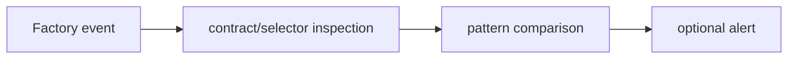

# Token Pattern Monitor

**Contract selector/bytecode comparison and BSC factory-event monitoring.**

  [](LICENSE)

[Overview](#overview) · [Quickstart](#quickstart) · [Example](#example) · [Validation](#validation) · [Documentation](#documentation)

## Overview

A contract-pattern research toolkit that compares selectors/checksums and monitors new BSC token events.

**Stack:** JavaScript · ethers · axios · Python research helpers · Docker

## A pattern match is an inspection signal

| Component | Behavior |
| --- | --- |
| Compare | Selector and bytecode helpers compare contract patterns. |
| Observe | A WebSocket monitor reads configured factory events. |
| Report | Optional Telegram output reports selected matches. |

## Processing path



## Quickstart

```console
npm install --ignore-scripts
node --check monitor.js
node --check compare_contracts.js
```

The commands above install prerequisites or run the specified offline checks. Live collection, cloud operations, messaging and trading are separate operational steps when present.

## Example

**Inspect the workflow**

Inspect [compare_contracts.js](compare_contracts.js) and the selector helpers before using a live factory feed. Trace the pattern being compared and the matching condition. A selector or checksum match is evidence for further inspection, not proof of equivalent behavior or contract safety.

## Configuration and storage

`WS_RPC`, `TELEGRAM_BOT_TOKEN` and `TELEGRAM_CHAT_ID` are local inputs for the operational monitor. Research output and templates are file-based; no application database is declared.

## Repository guide

| Location | Responsibility |
| --- | --- |
| [monitor.js](monitor.js) | Factory-event monitoring |
| [compare_contracts.js](compare_contracts.js) | Pattern comparison |
| [fetch_selectors.js](fetch_selectors.js) | Selector inspection |
| [package.json](package.json) | Runtime dependencies |

## Validation

The quickstart lists the declared checks. No passing CI or coverage claim is implied by the technology badges.

## Scope and operational boundaries

No dedicated offline behavior suite is declared in package scripts. Syntax checks do not open a WebSocket or send Telegram messages. Provider/factory compatibility requires separate verification.

## Documentation

- The repository guide above links directly to the implementation and configuration files.

## License and attribution

Project-authored source code is licensed under the [MIT License](LICENSE). Third-party components and datasets retain their respective rights and licenses.
